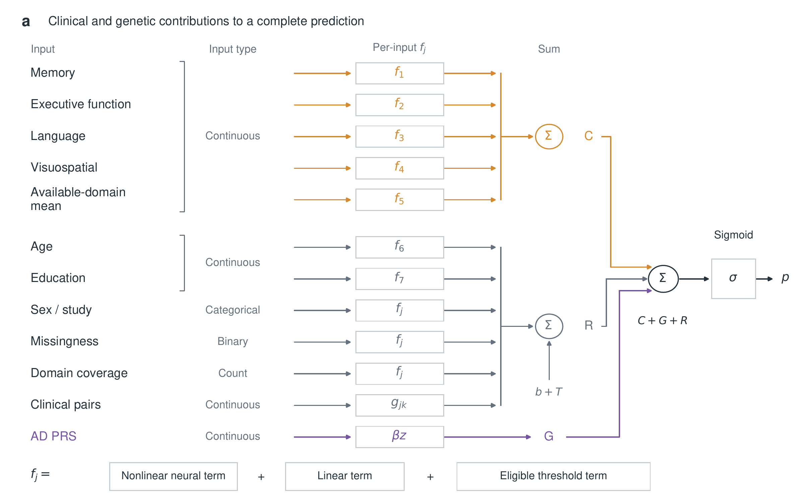

# PRISM-AD

Release 1.4.2 (29 October 2026) refines the descriptive calibration and
marginal-contribution panels. The same private bin coordinates and fold-specific
quartiles are retained. Scientific calculations, model fits, inference and
supplementary numbering remain unchanged.

Release 1.4.1 aligned supplementary exports with manuscript first-citation
order. Supplementary figures show optimization curves (S1), age distributions
(S2) and PRS increments (S3).

Release 1.4.0 added descriptive calibration and marginal-contribution panels,
a full-first-CN forecast export for authorized private follow-up analyses, and
a planned AD follow-up sensitivity command. Those association regressions are
separate from PRISM-AD training and are not external validation.

Code for interpretable cognitive prognosis with explicit clinical and genetic
contributions. PRISM-AD learns nonlinear clinical functions and retains a
distinct PRS term. Its predicted probability is sigmoid(C + G + R), where C
contains cognitive main functions, G the genetic term and R all remaining terms.
The primary outcome is first recorded MCI after normal cognition. AD dementia
after MCI is a separate secondary outcome, with three- and five-year horizons.

## Install and run synthetic checks
Use a separate Python 3.11 model environment. Full neural-model checks require
PyTorch, while the basic synthetic example uses NumPy and pandas.

    git clone https://github.com/davidroad/prismAD.git
    cd prismAD
    python -m pip install -e '.[analysis]'
    python -m prism_ad demo

For the recorded model environment and neural scientific tests:

    python -m pip install -r environments/model-requirements.txt
    python -m pip install --no-deps -e .
    python -m prism_ad demo --with-model
    python -m unittest discover -s tests -v

## Controlled-data boundary
ADSP/PHC source files and participant-level derivatives are not distributed here.
This includes genotype/variant data, roster and linkage files, individual PRS,
clinical or cognitive records, per-person predictions/contributions, model
checkpoints, anonymous individual examples and derived reconstruction objects.
The supplied tests and demo generate synthetic data.

Obtain any required controlled inputs separately through the applicable
authorized access process. Keep them and all analysis outputs in private local
storage. Input schemas and placeholder configuration paths describe the interface
without supplying the underlying records. See [INPUTS.md](docs/INPUTS.md),
[RUNNING.md](docs/RUNNING.md) and [DATA_PRIVACY.md](docs/DATA_PRIVACY.md).

This release contains code, configuration templates, environments and the
data-free Figure 1a schematic. It does not include cohort result tables, figure
source data, plotted individual records, manuscript files or full-precision
reconstruction inputs. Figure and statistical commands require separately
authorized local inputs. Code availability does not establish a fully executable
raw-data reproduction or grant access to the controlled datasets.

## Code navigation
See [CODE_INDEX.md](docs/CODE_INDEX.md) for the module-to-workflow mapping.

## Release check
Before distributing a directory or committing staged changes:

    python scripts/check_public_release.py
    python scripts/check_public_release.py --staged

See LICENSE.txt and THIRD_PARTY_NOTICES.md for reuse and third-party terms.

## Reproduction modes and current reporting
The public checkout provides the analysis implementation and synthetic checks.
The separate, private Local collaborator package adds checked server paths,
input-identity indexes and execution wrappers. It includes:

- scripts/reproduce.py for validating and replaying authorized frozen inputs.
- scripts/reproduce_corrected.py for complete refitting in a new private directory.
- scripts/build_publication_tables.py and scripts/build_reporting_tables.py for
  the final publication-format tables, including characteristics, follow-up and
  calibration reporting.

These Local paths are not files in this GitHub checkout. No Local configuration,
input hashes, result tables or manuscript documents are distributed on GitHub.
The final reporting helpers were executed and reconciled with the manuscript
separately from the public synthetic checks. A documentation update does not
require rerunning the unchanged model grid. Use the complete private refit only
when intentionally reproducing or changing the authorized inputs or analysis.

## Review-requested checks
The commands eligibility-audit and model-scale-checks require authorized
external inputs and private external output directories. The former replays
entry eligibility and endpoint construction against full diagnostic histories.
The latter compares fitted genetic terms within each fitted fold and raw PRS
on a common reference scale. It retains the original shared cognitive deciles
and uses a separate four-comparison BH family. Raw-PRS differences are SD units,
not disease odds ratios. See docs/RUNNING.md for execution and limitations.

## Follow-up sensitivity and expanded figures
The followup-sensitivity command constructs a first-recorded-AD endpoint from
the first eligible CN forecasts and full subsequent diagnostic history. It fits
the specified fold-stratified Cox working model and a censoring-weighted
five-year raw-PRS contrast. It requires a private frozen plan and tie-convention
amendment, authorized forecast/history inputs and R survival. All effect
estimates and assumption diagnostics stay in private output storage.

Figures 2 and 3 retain their original a–d panels. Their additional e/f panels
use mass-weighted calibration summaries and within-fold marginal C/G medians
and IQRs. IQRs describe participant spread; no new tests are attached to these
descriptive panels. Fixed canvas exports preserve panel-letter gutters.
